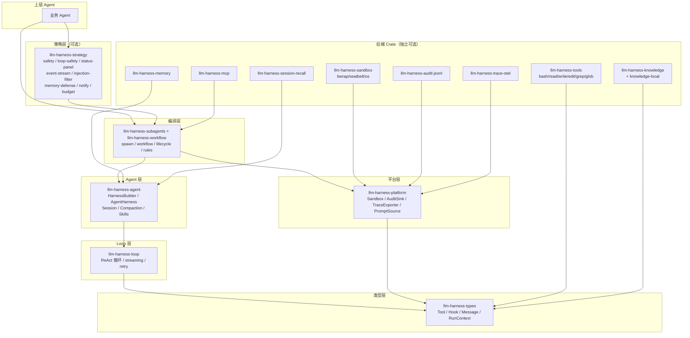

# llm-harness-runtime

> **[MISSION.md](MISSION.md)** — 本仓库及 harness 小组的纲领文档。从第一性原理推导 harness 的本质与使命，所有开发/业务决策以此为准。

Rust implementation of the oh-my-harness LLM agent orchestration runtime: workflow engine, agent harness, tools, event stream, and sandboxing.

> **Private repo.** Source is not distributed. Public consumers receive only git rev crates for Rust downstreams.

---

## 架构总览



---

## Crate 地图

| Crate | 说明 | 文档 |
|-------|------|------|
| `llm-harness-types` | 核心 trait 与类型（Tool/Hook/Message/RunContext） | [crate-reference.md](docs/crate-reference.md) |
| `llm-harness-loop` | Agent loop 引擎：ReAct 循环、streaming、retry+backoff | crate 内 lib.rs |
| `llm-harness-agent` | HarnessBuilder、AgentHarness、Session、Compaction、Skills | crate 内 lib.rs |
| `llm-harness-subagents` | Sub-agent spawn、async delivery、main↔sub 通信 | [runtime-framework.md](docs/runtime-framework.md) · [ORCHESTRATION.md](docs/ORCHESTRATION.md) |
| `llm-harness-workflow` | Workflow 引擎、task 持久化、规则匹配 | [runtime-framework.md](docs/runtime-framework.md) · [ORCHESTRATION.md](docs/ORCHESTRATION.md) |
| `llm-harness-platform` | 横切 trait（Sandbox/AuditSink/TraceExporter/PromptSource） | [crate-reference.md](docs/crate-reference.md) |
| `llm-harness-strategy` | 策略层：safety、loop-safety、status-panel、event-stream、injection-filter、memory-defense、notify、budget | **[strategy-guide.md](docs/strategy-guide.md)** |
| `llm-harness-tools` | 内置工具：bash、read、write、edit、grep、glob | **[tools-guide.md](docs/tools-guide.md)** |
| `llm-harness-mcp` | MCP 协议集成：传输、会话、多服务器管理、版本锁定 | **[mcp-guide.md](docs/mcp-guide.md)** |
| `llm-harness-knowledge` | 后端无关的知识访问契约 | [crate-reference.md](docs/crate-reference.md) |
| `llm-harness-knowledge-local` | 本地 Markdown/Text 知识源（BM25） | [crate-reference.md](docs/crate-reference.md) |
| `llm-harness-memory` | 长期记忆系统（读写分离 + 变更网关） | [crate-reference.md](docs/crate-reference.md) |
| `llm-harness-session-recall` | 跨 Session 历史召回（in-memory + SQLite FTS5） | [session-recall-integration.md](docs/session-recall-integration.md) |
| `llm-harness-sandbox` | 沙箱后端：bwrap（Linux）、seatbelt（macOS）、os | crate 内 lib.rs |
| `llm-harness-audit-jsonl` | JSONL 审计后端（SHA-256 hash chain） | [crate-reference.md](docs/crate-reference.md) |
| `llm-harness-trace-otel` | OpenTelemetry 追踪导出（OTLP → Jaeger/Tempo） | [crate-reference.md](docs/crate-reference.md) |
| `llm-harness-live-tests` | 真实 LLM 集成测试（24 examples + 62+ tests） | 见下方快速上手 |
| `session-viewer` | Session 可视化工具 | 见下方 |

---

## 快速上手

`llm-harness-live-tests` 包含 24 个可运行的 example，覆盖全部架构层。这是最好的上手入口：

```bash
# 配置 API key
source .env

# 运行单个 example（以工具调用为例）
cargo run --features live-llm -p llm-harness-live-tests --example 02_tool_calling
```

### Example 索引

| # | Example | 覆盖能力 |
|---|---------|---------|
| 01 | `prompt_streaming` | 流式输出 |
| 02 | `tool_calling` | 工具调用 |
| 03 | `dynamic_config_multi_turn` | 多轮对话 + 动态配置 |
| 04 | `session_branch` | Session 分支 |
| 05 | `compaction` | 上下文压缩 |
| 06 | `skills_model_switch` | Skills + 模型切换 |
| 07 | `hooks` | Hook 机制 |
| 08 | `workflow` | Workflow 引擎 |
| 09 | `workflow_recovery` | 崩溃恢复 |
| 10 | `sandbox` | 沙箱隔离 |
| 11 | `spawn_subagent` | 子 Agent 派生 |
| 12 | `tracing_audit` | 追踪 + 审计 |
| 13 | `budget_pricing` | 预算 + 定价 |
| 14 | `rules_approval` | 规则审批 |
| 15 | `safety_injection` | 安全 + 注入防御 |
| 16 | `status_panel` | 状态栏 + TODO |
| 17 | `source_instruction` | 项目指令注入 |
| 18 | `loop_safety` | 循环安全（max_turns/repetition/failure_breaker/death_spiral/truncation） |
| 19 | `memory_defense_guard` | 记忆防线 |
| 20 | `notify` | 通知 |
| 21 | `context_aware_compact` | Context-aware 压缩 |
| 22 | `fs_tools` | 文件工具（bash/read/write/edit/grep/glob） |
| 23 | `infra_integration` | 基础设施集成 |
| 24 | `otlp_jaeger` | OTLP 追踪导出 |

### 运行全部测试

```bash
source .env
cargo test --features live-llm -p llm-harness-live-tests -- --test-threads=1
```

---

## 核心能力

### Loop Engine
ReAct 循环（思考→调工具→看结果→再思考），支持 streaming、retry + 指数退避 + 随机抖动、中止/取消传播。

### Agent Harness
`HarnessBuilder` fluent API → `AgentHarness`。Session 持久化（InMemory + Jsonl）、分支/fork/navigate、compaction（可自定义 prompt + 熔断器）、skills、prompt templates、model switching。

### Workflow Engine
多步骤工作流：分阶段执行、条件跳转、回流/返工、崩溃恢复。详见 [ORCHESTRATION.md](docs/ORCHESTRATION.md)。

### Strategy Layer
15 个策略 Plugin：安全防护、循环安全（5 个 Hook）、状态栏+TODO、事件流（timer/heartbeat/filter/webhook/shell_monitor）、注入防御、来源标记、记忆防线、通知、工具输出保护、MCP 凭证保护、compaction prompt、项目指令注入、审计、预算控制。详见 [strategy-guide.md](docs/strategy-guide.md)。

### Tools
6 个内置工具：bash、read、write、edit、grep、glob。详见 [tools-guide.md](docs/tools-guide.md)。

### MCP
完整 MCP 协议实现：stdio/HTTP/SSE 传输、多服务器管理、工具适配、提示与资源发现、版本锁定、凭证作用域。详见 [mcp-guide.md](docs/mcp-guide.md)。

### Knowledge & Memory
后端无关的知识访问契约 + 本地 BM25 知识源 + 长期记忆系统（读写分离 + 变更网关）。详见 [crate-reference.md](docs/crate-reference.md)。

### Session Recall
跨 Session 历史召回（in-memory + SQLite FTS5）。详见 [session-recall-integration.md](docs/session-recall-integration.md)。

### Sandboxing
Linux（bubblewrap）、macOS（seatbelt）、跨平台（OS 原生 + 路径限制）。

### Observability
审计日志（JSONL + SHA-256 hash chain）+ OpenTelemetry 追踪（OTLP → Jaeger/Tempo）。

---

## 文档索引

| 文档 | 内容 |
|------|------|
| [MISSION.md](MISSION.md) | 使命与第一性原理 |
| [strategy-guide.md](docs/strategy-guide.md) | 策略层 15 个模块使用指南 |
| [mcp-guide.md](docs/mcp-guide.md) | MCP 集成指南 |
| [tools-guide.md](docs/tools-guide.md) | 内置工具使用指南 |
| [crate-reference.md](docs/crate-reference.md) | 基础设施 crate 参考（types/platform/audit/trace/knowledge/memory） |
| [runtime-framework.md](docs/runtime-framework.md) | Runtime crate 框架文档 |
| [ORCHESTRATION.md](docs/ORCHESTRATION.md) | WorkflowEngine 编排能力总览 |
| [product-roadmap.md](docs/product-roadmap.md) | 产品路线图 |
| [session-recall-integration.md](docs/session-recall-integration.md) | Session Recall 集成指南 |
| [docs/design/](docs/design/) | 设计规范文档（历史 spec） |
| [docs/archive/](docs/archive/) | 已归档的研究/分析文档 |

---

## 作为依赖消费

Downstream Rust 项目通过 git rev 消费 workspace crates：

llm-harness-workflow = { git = "https://github.com/oh-my-harness/llm-harness-runtime", rev = "<commit-sha>" }
```

---

## Session Viewer

`session-viewer` 可视化 `JsonlSessionRepo` 持久化的 agent session。

```bash
cargo run -p session-viewer --bin session_viewer -- /path/to/sessions [--port PORT]
```

读取磁盘格式（`meta.json` + `entries.jsonl`），在浏览器渲染自包含 HTML 页面。支持 Session 树分支切换、消息渲染（含折叠的 thinking 和 tool-use 块）、token 用量统计、配置条目展示、图片 base64 内联。

---

## 版本管理

Workspace version 在根 `Cargo.toml` 的 `[workspace.package]`。发布新版本时 bump `Cargo.toml` 中的 version。

---

## Python SDK

Python SDK（`llm_harness_py`）已迁移到 [github.com/oh-my-harness/Senza](https://github.com/oh-my-harness/Senza)。Senza 通过 git 依赖引用本仓库的 crate。
