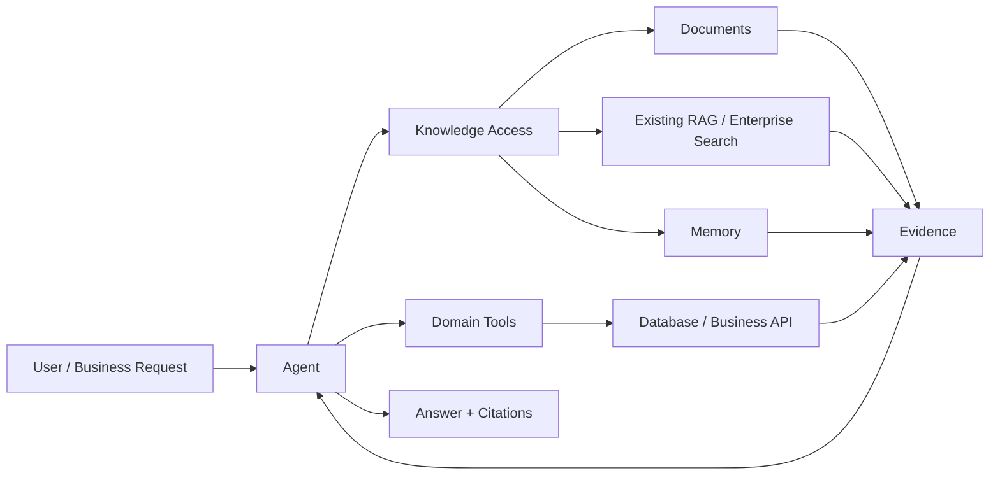
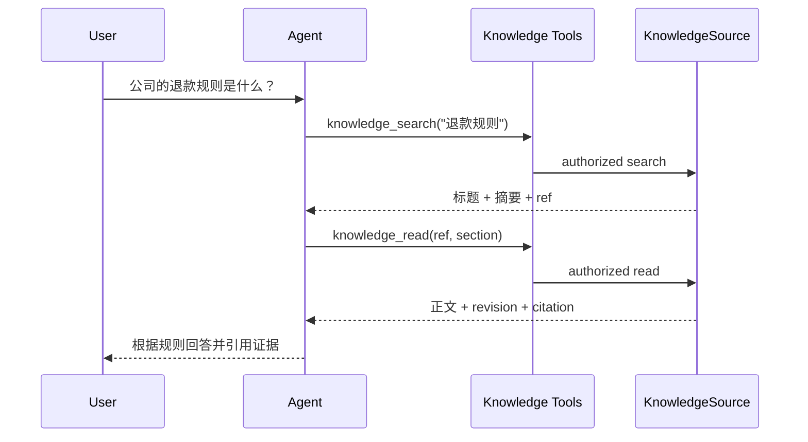
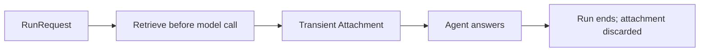
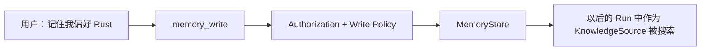
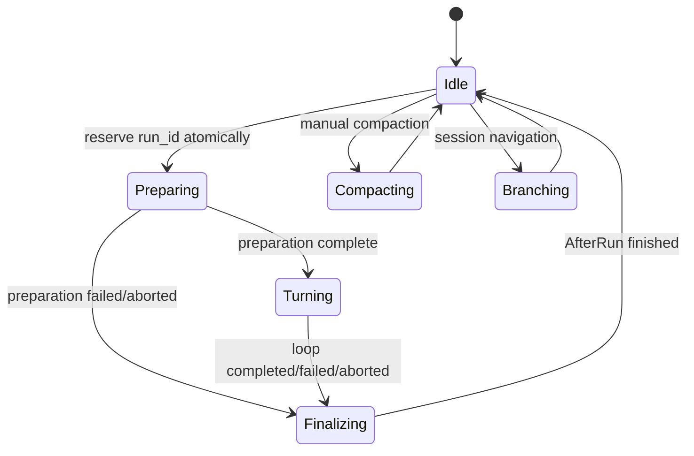
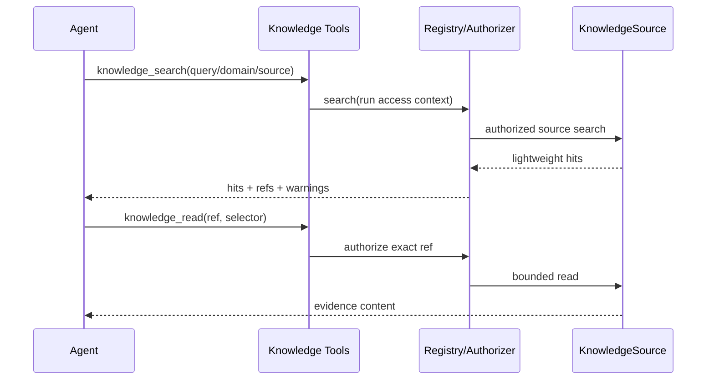

# Agent 业务知识与 Memory 目标架构

> 状态：Draft / 待评审
>
> 日期：2026-07-21
>
> 性质：目标架构设计，不以保持现有内部 API 兼容为约束

## 摘要

本设计把 Agent 的外部认知能力分成两个层次：

- **Knowledge Access**：Agent 发现、搜索、读取和引用大量业务知识的通用能力。
- **Memory**：Knowledge Access 之上的可写能力，用于保存可跨 run/session 复用的用户、
  项目或 Agent 记忆。

Knowledge Access 不是一个更大的 `call_rag` 工具。它定义一套稳定的运行协议：

- 每次 run 携带可信身份和授权上下文；
- Agent 先搜索轻量候选，再按需读取证据；
- 文档、实时 API、结构化查询和 Memory 使用统一的来源与引用语义；
- 自动召回通过一等的 transient attachment 进入当前 run，不修改 system prompt，也不进入
  Session；
- 显式 Tool 调用分别定义“当前模型可见内容”和“Session 持久化投影”；
- 所有引用都包含来源、版本和时间语义；
- Memory 写入、删除和自动沉淀分别授权，默认关闭。

为了保证这些语义可靠，目标架构会先重构通用 run 生命周期，再实现 Knowledge/Memory。
不采用 Plugin 本地 cache、字符串标记替换、固定 scope 或特殊工具名判断等过渡方案。

## 如何阅读本文

本文有两层：

1. **概念与使用方式**：回答“这些东西分别是什么、为什么需要、业务怎么用”。
2. **技术目标架构**：回答“runtime 内部如何把权限、生命周期、Session 和引用做正确”。

只关心产品能力和业务接入时，先读到“业务定制边界”即可。后面的 Rust DTO、
cursor 和状态机是实现协议，不是理解整体方案的前置条件。

## 先从业务问题出发

LLM 自身只知道训练时学到的内容和当前上下文中的内容。真实业务中，Agent 还需要面对：

- 远大于模型上下文的产品文档和制度；
- 按用户、tenant、项目隔离的企业知识；
- 会持续变化的订单、库存、账户和指标；
- 来自文件、搜索服务、数据库、API 和现有 RAG 系统的不同数据；
- 用户希望跨会话保留的偏好、项目约定和任务进度。

如果每个业务都自己给 Agent 加一个 Tool，最终会反复解决同样的问题：当前用户能不能查、
返回多少内容、这段资料是什么版本、如何引用、是否写入会话、取消时如何停止，以及
多个数据源部分失败时怎么表达。

因此本设计不是帮业务选一个向量库，而是在 runtime 内建立一套通用的“Agent 如何
使用外部知识”的协议。

## 一张图看懂整体关系



从 Agent 看，外部能力仍然表现为 Tool 或当前 run 的临时上下文。多出来的 Knowledge Access 层
不替代业务系统，它统一的是授权、搜索/读取、版本、引用、预算和失败语义。

## 核心概念

### Agent

本文的 Agent 不只是 LLM。它是“模型 + Tool + Prompt + Session + runtime 控制”组成的
完整运行单元。模型做推理和选择，runtime 负责边界、调度和可验证性。

### Run 与 Turn

- **Run**：从一次新请求开始，到 Agent 完成、失败或被取消为止。
- **Turn**：Run 内的一次模型调用。一个 Run 可以有多个 Turn，中间穿插多次 Tool 调用。

例如 Agent 先搜索文档、再读取章节、最后回答，这是一个 Run，但通常包含三个或更多 Turn。

### Session

Session 是会话发生过的事实日志，包括用户消息、Agent 回复、Tool 调用和压缩记录。

Session 不是知识库：

- Session 回答“这段对话发生了什么”；
- Knowledge 回答“外部世界现在有什么可查资料”；
- Memory 回答“哪些信息值得跨对话继续使用”。

把大段文档正文全部塞进 Session，会让历史越来越大、内容过期、权限难以重新检查，
因此本设计只在 Session 中保留安全投影和可重新读取的引用。

### Knowledge Access

Knowledge Access 是一套只读访问协议，提供：

- 发现当前用户能看到哪些知识源；
- 搜索轻量候选；
- 按需读取正文或指定章节；
- 返回可验证的来源、版本和时间；
- 处理权限、分页、预算、取消和部分失败。

它不规定底层一定使用 RAG、Embedding 或向量库。

### KnowledgeSource（知识来源）

KnowledgeSource 是“一个可被 Agent 搜索和读取的知识来源”。例如：

- 本地 Markdown/Text 文档目录；
- 企业搜索服务；
- 已有的 RAG API；
- 产品知识图谱；
- 结构化业务查询；
- 用户 MemoryStore。

KnowledgeSource 像一个标准插口。runtime 不知道它背后是文件系统、Elasticsearch、PostgreSQL
还是向量库，只要它能履行统一的 search/read 协议。

### Domain Tool

不是所有业务数据都要变成 KnowledgeSource。订单状态、实时库存、账户余额等有明确业务语义
和时效要求的数据，应继续使用 `get_order_status`、`query_inventory` 等 Domain Tool。

Domain Tool 不经过通用 search/read 流程，但它可以返回统一 Evidence，从而与文档知识使用相同的
引用、新鲜度、Session Projection 和审计机制。对数据库的通用只读报表检索可以实现为
KnowledgeSource，而有副作用的业务动作永远使用独立 Domain Tool。

### Search 与 Read

Search 和 Read 分开：

- **Search** 只返回标题、短摘要、分数和引用，用来判断“哪些内容值得看”。
- **Read** 根据引用读取具体文档、章节、行或 chunk，用来获得真正的回答证据。

这和人先查目录、再翻到某一页的过程相同。分开后，Agent 不需要一次把 top-k 的全部
正文放入上下文。

### Evidence 与 Citation

- **Evidence** 是 Agent 在当前 Run 中真正读到的证据，包含来源、版本、获取时间和摘要。
- **Citation** 是最终答案中指向 Evidence 的引用标识。

两者分开是因为“查到过某篇文档”不等于“最终答案的这句话已经有证据”。严格模式
下，Agent 只能引用当前 Run 实际读取过的 Evidence。

### Transient Attachment

Transient Attachment 是“只在当前 Run 中给模型看的临时资料”。

它主要用于自动召回：在 Agent 开始回答前，runtime 先根据用户问题搜索一次，然后把选中
的资料作为 attachment 交给 Agent。它不是 system prompt，不会伪装成用户消息，也不会
写入 Session。Run 结束后它就被释放。

### Session Projection

Tool 执行时可能给当前 Agent 返回几十 KB 文档，但 Session 不应因此永久保存整段正文。

Session Projection 就是 Tool 对“会话历史里应该保存什么”的明确决策：

- 小且安全的结果可以完整保存；
- 搜索结果保存摘要和引用；
- 文档读取默认只保存“读过哪个版本的哪一段”，不保存正文。

### Memory

Memory 不是完整聊天记录，也不是“每轮对话后自动总结一段文字”。

它是 Knowledge Access 之上的可选写入能力：

- 对 Agent 而言，已保存的 Memory 通过 read source 和其他 KnowledgeSource 一样被
  search/read；
- 对应用而言，MemoryStore 可以自定义存储、分类、TTL、去重和删除策略；
- 对用户而言，可以完全关闭、只在明确说“记住”时写入，或者在明确策略下自动沉淀。

### Scope、Principal 与 Authorization

- **Scope** 描述数据属于哪个 tenant、项目或 namespace。
- **Principal** 描述当前是谁在请求。
- **Authorization** 决定这个主体能否发现、搜索、读取、写入或删除某个资源。

它们由可信的业务应用在每次 Run 开始时提供，不由模型从 prompt 中猜，也不允许模型在
Tool 参数中自己声明“我是管理员”。

### Registry、Router、Planner、Coordinator 与 Assembler

这几个名字是不同职责，可以用“图书馆”理解：

| 概念 | 直白解释 | 图书馆类比 |
|---|---|---|
| Registry | 管理有哪些知识源，并统一执行授权、搜索和读取 | 总服务台 |
| Router | 判断这个问题应该查哪些知识源 | 先选图书馆/书架 |
| Planner | 从搜索候选中决定真正要读哪些段落 | 列阅读清单 |
| Coordinator | 执行搜索和并发读取，处理超时、取消和部分失败 | 跑腿取书和进度管理 |
| Assembler | 去重、截断、标注引用，组装成 Agent 能用的临时材料 | 整理成阅读包 |

把它们分开不是为了多造几个类，而是让业务可以只替换自己关心的部分。例如业务可以
保留通用 Registry，只换成自己的 Router 和 reranker。

### Plugin 与 Policy

- **Plugin** 是安装单元，用来把 Tool、Hook 和共享服务注册到 Harness。Knowledge Plugin 只安装
  只读访问，Memory Plugin 才会安装写入、删除或 capture 能力。
- **Policy** 是可替换的业务决策，例如是否自动召回、允许读多少内容、引用是否必须、
  哪些信息可以写入 Memory。

Plugin 实例保存的是不可变配置和共享服务，不保存“当前用户”或“上一次检索结果”这类
per-run 状态。

## 和“给 Agent 加一个 RAG Tool”有什么不同

两者不是互斥关系。现有 RAG Tool 可以成为一个 KnowledgeSource，或者继续作为领域 Tool。

| 仅加一个 RAG Tool | Knowledge Access 层 |
|---|---|
| 通常绑定一个检索后端 | 可组合文档、RAG、搜索、API 和 Memory |
| Tool 自己定义权限和错误 | 每次 Run 统一传递身份并 fail-closed |
| 常见做法是一次返回 top-k 全文 | 先 search，再按需 read |
| 引用、版本和部分失败各自约定 | 使用统一的 ref/evidence/error 语义 |
| Tool 结果往往全量进入历史 | 当前内容和 Session Projection 分开 |
| 自动召回常靠 prompt 拼接 | 使用一等 transient attachment |

如果业务只有一个简单知识库，Agent 最终看到的仍然可以只是 `knowledge_search` 和
`knowledge_read` 两个 Tool。差别在于底层语义已经标准化，以后增加数据源、权限或 Memory 时
不需要推翻。

## 四种实际工作方式

### 1. 不使用 Knowledge 和 Memory

不安装 Knowledge/Memory Plugin。Agent 保持现有行为，runtime 不自动检索、不自动保存任何内容。

### 2. Agent 显式调用 Tool 查知识



这是默认且最容易观测的模式。Agent 自己决定什么时候查、查哪些来源、读哪个章节。

### 3. 业务开启自动召回



适合几乎每个问题都需要固定业务资料的场景。它是可选策略，不是 Knowledge Plugin 的默认
副作用。调用方可以指定哪些问题召回、查哪些源和使用多少 token。

### 4. 显式或自动写入 Memory



明确写入是首选路径。自动 Capture 默认关闭，只在业务定义了值得保存的内容、敏感信息
规则、TTL、删除和去重策略后才开启。

## 纯文档知识库怎么对应

纯文档是这套设计的第一个正式落地场景：

```text
Agent
  -> knowledge_search
  -> LocalDocumentSource 搜索文件目录/索引
  -> knowledge_read
  -> LocalDocumentSource 通过只读文件能力读取指定章节
  -> Agent 带引用回答
```

从 Agent 角度看，这就是“调用 Tool 读文件”。不同点是 Tool 不接受任意系统路径，只接受
搜索返回的 opaque ref；底层使用只读、受 root 限制的文件能力。因此纯文档不需要向量库，
首版用 Markdown/Text + BM25 + section read 即可完整跑通。

## 业务定制边界

runtime 管理“协议必须正确”，业务管理“具体怎么查、怎么排、怎么记”。

| 能力 | runtime 提供 | 业务可定制 |
|---|---|---|
| KnowledgeSource | search/read/ref/error 协议 | 文件、RAG、DB、API 的具体实现 |
| Authorization | 每次 Run 传递主体并 fail-closed | tenant、RBAC、ABAC、文档 ACL |
| Router | 稳定路由接口 | 领域、关键词、规则或 LLM 路由 |
| Ranking | 预算和聚合语义 | BM25、vector、hybrid、reranker |
| Context assembly | 临时 attachment 协议 | 去重、权威性、新鲜度、token 分配 |
| Citation | ref/evidence/校验协议 | UI 样式、严格度、领域引用格式 |
| Memory | 可选写入/删除协议 | 存储、schema、分类、TTL、capture policy |
| Observability | 结构化事件和预算数据 | 监控平台、审计和评测集 |

因此，上层业务可以只使用 LocalDocumentSource，也可以接入已有 RAG；可以完全不安装
Memory，也可以自定义 Memory schema 和写入策略。核心协议不强迫业务使用统一的知识库
产品或统一的记忆组织方式。

---

## 技术目标架构

以下部分开始定义 runtime 和可选 crate 的正式协议。

## 实施原则：最终态协议，小步垂直交付

目标架构不降级，实现方式从“先完成一个巨大 Phase 0”改为“按依赖拆分最终协议，
逐个完成端到端切片”。

1. 每个 PR 只引入一个可独立解释、测试和迁移的协议切片。
2. 新 crate、新 Tool 和新 runtime 协议优先以短生命分支合入主干，不在长期 feature branch 上
   累积超大 merge。
3. 每个用户可见切片都必须有端到端交付物，例如“Agent 能搜文档、读 section、
   带可验证引用回答”，不以“框架已建好”作为验收。
4. 每个可见能力完成后，用 `../llm-tutor` 的现有 RAG、Agent 和 Memory 做真实迁移
   验证；迁移不过去视为协议问题，不在业务侧堆适配层。
5. 允许在不合并的 throwaway experiment/benchmark 中验证检索参数，但不把全文写入
   Session、additional message 模拟 attachment、无授权默认或隐式 `Full` 投影作为
   受支持路径合入主干。
6. feature flag 用于开关已完成的可选能力，不用于长期维护两套生命周期或持久化
   语义。
7. 不要求整个 runtime v2 完成后才开始 Knowledge；只先实现当前垂直切片真正依赖的
   核心协议。
8. API 变更以单次、显式迁移完成：同一个协议不提供无期限的 old/new 双路径。

## 设计目标

1. 支持远大于模型上下文窗口的业务知识空间。
2. 支持纯文件文档、企业搜索、全文/向量检索、数据库、业务 API 和 Memory。
3. 知识访问权限绑定到每次 run，而不是绑定到模型参数或全局可变状态。
4. 检索内容不获得 system instruction 权限。
5. 自动召回内容默认不持久化；显式 Tool 结果使用明确的 Session Projection。
6. Session 仍然是会话事实日志，Memory 仍然是跨会话可复用数据。
7. 知识源、路由、授权、上下文组装和存储彼此解耦。
8. Workflow 和 Subagent 只能获得显式授予且可收窄的知识权限。
9. 上层业务可以替换任何策略或实现，也可以只使用协议的一部分。
10. 协议具备稳定引用、版本、部分失败、取消、分页和审计语义。

## 非目标

- runtime 不定义统一业务本体、知识图谱或 Memory 分类学。
- runtime 不绑定固定 Embedding 模型、向量数据库或 reranker。
- runtime 不负责企业数据采集、ETL、文档审批和数据治理流程。
- runtime 不把所有结构化/实时业务查询转换成文本 RAG。
- runtime 不默认保存完整对话或所有模型推断为长期 Memory。
- runtime 不依赖 prompt 文本约定来实现权限、隔离或生命周期正确性。

## 核心架构决策

### 1. Knowledge 与 Memory 分层

Knowledge 是只读访问协议；Memory 是由只读知识源和写存储组合出来的可选能力。

```text
KnowledgeSource
├── LocalDocumentSource
├── EnterpriseSearchSource
├── DatabaseKnowledgeSource
└── MemoryReadSource              # search/read

MemoryService
├── read_source: KnowledgeSource
└── write_store: MemoryStore       # upsert/delete
```

同一后端类型可以同时实现 `KnowledgeSource` 和 `MemoryStore`，但 trait 不继承。这允许
写入使用 PostgreSQL，读取使用 Elasticsearch/vector index，也允许简单 KV store 只负责
写入，由独立 read model 提供检索。

只安装 Knowledge Plugin 不会产生任何长期写入。Memory Plugin 独立注册 write/forget/capture
能力。

### 2. Session 与外部知识分离，但保留真实工具事件

Session 保存真实发生的用户消息、模型回复和工具调用。外部知识有两种进入模型的路径：

- 自动召回：作为 transient attachment，仅存在于当前 run。
- 显式 search/read Tool：在当前 run 中向模型返回完整结果，在 Session 中保存由 Tool 明确
  指定的安全投影。

因此，“Session 与知识分离”不等于删除工具调用事实，而是避免把大段、敏感或会过期的知识
正文无条件保存进 Session。

### 3. 权限属于 run，不属于 Plugin

Knowledge Plugin 是无用户状态的共享配置。身份、tenant、project、授权主体等信息由应用在
每次 `RunRequest` 中提供，并通过 typed run extension 传入。

这允许同一个 Harness/Plugin 配置安全服务多个 run，同时避免固定 scope、线程本地变量或
可变全局状态。

### 4. Transient Context 是核心一等概念

自动召回不是 system prompt 拼接，也不是伪造 Session Message。核心 `AgentContext` 原生支持
transient attachments，并由 provider conversion 层以低权限上下文发送给模型。

### 5. 搜索与读取分离

`search` 返回轻量 hit、摘要、定位信息和稳定引用；`read` 才返回正文。Agent 可以逐步缩小
范围，不会因一次 top-k 把大量 chunk 注入上下文。

### 6. 结构化和实时知识保留领域语义

订单、库存、账户、指标等数据优先由领域 Tool 查询。它们不必伪装成 `KnowledgeSource`，但
应返回统一 Evidence Envelope，使引用、时间和审计语义一致。

## 目标项目结构

```text
crates/
├── llm-harness-types/
│   ├── run.rs                    # RunId/RunRequest/RunContext/RunRecord
│   ├── context.rs                # DataBlock/ContextAttachment/AgentContext
│   ├── hooks.rs                  # 带 RunContext 的生命周期 Hook
│   └── tool.rs                   # ToolResult/ToolFailure + Session Projection
│
├── llm-harness-loop/             # 消费 RunContext 和 transient attachments
├── llm-harness-agent/            # 原子 run 生命周期、Session、Plugin
├── llm-harness-runtime/          # Workflow/Spawn/Control/Platform
│
├── llm-harness-runtime-knowledge/
│   ├── source.rs                 # KnowledgeSource 协议
│   ├── access.rs                 # scope/principal/authorizer/delegator
│   ├── evidence.rs               # provider 注册、receipt 验证和引用签发
│   ├── registry.rs               # source catalog、联邦搜索、分页
│   ├── router.rs                 # source/domain 路由
│   ├── planner.rs                # 纯策略：hit 选择和 read 计划
│   ├── retrieval.rs              # 路由、搜索和 read 编排
│   ├── assembler.rs              # 纯组装：去重、预算、引用、attachment
│   ├── tools.rs                  # sources/search/read
│   └── plugin.rs                 # KnowledgePlugin
│
├── llm-harness-runtime-knowledge-local/
│   ├── source.rs                 # LocalDocumentSource
│   ├── parser.rs                 # Markdown/Text parser
│   ├── index.rs                  # 可替换全文索引
│   └── revision.rs               # 文档 ID/版本/section
│
└── llm-harness-runtime-memory/
    ├── store.rs                  # 独立 MemoryStore 写协议
    ├── service.rs                # read source + write store + policy
    ├── tools.rs                  # write/forget
    ├── capture.rs                # CapturePolicy
    └── plugin.rs                 # MemoryPlugin
```

Knowledge/Memory DTO 在接口稳定前保留在可选 crate。通用的 Run、Context Attachment 和 Tool
Session Projection 属于所有扩展都会用到的 runtime 基础协议，应进入核心类型层。

## 核心 runtime 重构

### RunRequest 与 typed extensions

应用不再只向 Harness 传一个字符串，而是启动一个明确的 run：

```rust
pub struct RunRequest {
    pub initial_messages: Vec<AgentMessage>,
    pub extensions: RunExtensions,
}

pub struct RunContext {
    pub id: RunId,
    pub started_at: DateTime<Utc>,
    pub initial_messages: Arc<[AgentMessage]>,
    /// 应用在 RunRequest 中提供的只读输入，例如 KnowledgeAccessContext。
    pub extensions: RunExtensions,
    /// runtime/Plugin 在本 run 内使用的 typed state，例如 citation registry。
    pub local: RunLocalState,
}
```

`RunExtensions` 是进程内 typed extension map，保存 `Arc<T: Send + Sync>`：

- 不序列化；
- 不自动记录日志；
- 不暴露给模型；
- Hook 和 Tool 通过类型安全查询访问。

`RunExtensions` 在 run 创建后只读。`RunLocalState` 是独立的 per-run typed state store，只允许
runtime/Plugin 保存运行状态，随 RunContext 创建并随 RunRecord 释放。Knowledge Plugin 在其中
保存 citation 映射、已读取 ref、检索预算和 source warnings；不会在 Plugin 实例上保存这些
状态。

`RunExtensions`、`RunLocalState` 和持有它们的 `RunContext` 不实现 Serialize，也不自动实现
Debug，避免认证上下文或临时证据被通用日志和 Session 序列化意外输出。
两个 map 都使用 `TypeId` 作为类型键，不提供字符串 key 回退通道；
`RunLocalState` 的值必须自行保证并发安全，以支持并行 Tool 更新 citation 和预算状态。

Knowledge Plugin 从这里读取 `KnowledgeAccessContext`。缺失时 fail-closed。

Workflow 通过 `WorkflowEngine::run_with_request(WorkflowRunRequest)` 接收同一种 typed
extension，并把它按共享只读所有权传给本次调用中每个 LLM step attempt 的 `RunRequest`。
每个 step 仍创建独立 `RunId` 和 `RunLocalState`；request extension 不进入
`WorkflowEngine` 字段、checkpoint、`WorkflowState` 或 Session，因此恢复执行时必须由调用方
重新提供当前可信上下文。无上下文场景使用 `run()`，它委托给空的 `WorkflowRunRequest`。

Executor step 不隐式获得进程内身份对象；它继续只读取可持久化的 `WorkflowContext`。
step 内新建的子 Agent 也不自动继承父 step 的 extension，后续必须通过 D3 的显式 delegation
生成收窄后的 grant，不能把父级权限整包复制过去。

### 原子 run 生命周期

目标状态机：



关键语义：

1. run ID 分配、Idle 校验和 `Idle → Preparing` 在同一临界区完成。
2. auto-compaction 和 BeforeRun 都属于已保留 run 的 Preparing 阶段。
3. 一旦 run 被保留，Finalizing 必须且只能执行一次。
4. RunGuard 负责异常、取消和提前返回时进入 Finalizing。
5. Harness 不允许两个 run 共享一个生命周期槽；不依赖调用方串行保证正确性。

为了让“必定 Finalizing”在 async Rust 中真正成立，runtime 而不是调用方 future
持有 run driver：

```rust
pub struct RunHandle {
    pub id: RunId,
    // await completion / cancel / subscribe
}

pub fn start(&self, request: RunRequest) -> Result<RunHandle, RunStartError>;
pub async fn run(&self, request: RunRequest) -> Result<RunCompletion, RunStartError>;
```

`start` 在一次原子操作中保留 run 并启动 runtime-owned task；`run` 只是等待
`RunHandle` 的便利形式。丢弃 handle 不会丢弃 run，取消必须通过显式 cancellation
API。`RunGuard` 只保证状态转换和 finalizer 单次调度，不尝试在 `Drop` 中执行异步
Hook。runtime shutdown 会先 abort 活动 run，再在有界宽限期内完成 Finalizing。

### RunPreparation

BeforeRun Hook 操作一等的准备对象：

```rust
pub struct RunPreparation {
    pub system_prompt: Option<String>,
    /// BeforeRun 可以在原始输入基础上追加或规范化的有效输入。
    pub input_messages: Vec<AgentMessage>,
    pub attachments: Vec<ContextAttachment>,
}

pub struct BeforeRunCtx<'a> {
    pub run: &'a RunContext,
    pub preparation: &'a mut RunPreparation,
    pub resources: &'a AgentHarnessResources,
}

pub enum RunPreparationStage {
    NormalizeInput,
    EnrichContext,
    Validate,
}
```

初始 `system_prompt` 来自 Harness 不可变配置，BeforeRun 只修改本 run 的
`RunPreparation`，不回写 Harness 全局状态。`input_messages` 是可持久化的有效输入；
所有只应当在当前 run 可见的丰富内容必须放入 `attachments`，不能伪装成
additional message。

Preparing 不依赖 Plugin 注册先后的隐式偶然顺序，runtime 固定执行：需要时的 session
auto-compaction → `NormalizeInput` → `EnrichContext` → `Validate`。BeforeRun Hook 必须声明
stage 和稳定 ID；同一 stage 内若存在依赖，使用显式 dependency 拓扑排序，循环依赖在
Harness 构建时拒绝。Knowledge auto-retrieval 固定属于 `EnrichContext`。

不再提供从 messages 猜出来的 `prompt_text`。检索策略可以检查完整 initial messages、附件、
多模态内容或业务 extension。

### Transient Context Attachment

```rust
/// 只表达外部数据，不存在 Thinking 或 ToolUse 等非法状态。
pub enum DataBlock {
    Text { text: String, mime_type: Option<String> },
    Image { source: ImageSource },
    Document {
        name: Option<String>,
        media_type: String,
        data: BinarySource,
    },
}

pub enum AttachmentTrust {
    TrustedApplicationData,
    UntrustedExternalData,
}

pub struct ContextAttachment {
    pub id: String,
    pub label: String,
    pub trust: AttachmentTrust,
    pub content: Vec<DataBlock>,
    /// 运行时、UI 和引用组装使用，不发给模型。
    pub metadata: serde_json::Value,
}

pub struct AgentContext {
    pub system_prompt: Option<String>,
    pub messages: Vec<AgentMessage>,
    pub attachments: Vec<ContextAttachment>,
}
```

转换规则：

- attachments 不转换成 SessionEntry；
- untrusted attachment 永远不拼接到 system prompt；
- `DataBlock` 在类型上排除 Thinking/ToolUse，converter 不靠运行时“跳过非法 block”
  保证边界；
- provider 支持 document/context block 时使用原生 block；
- 不支持时由统一 converter 生成低权限 context message；
- `BinarySource` 只允许经过预算校验的 inline bytes 或 runtime-owned blob handle，不让
  provider 或模型根据附件内容任意拉取 URL；
- attachment 位于 Session 历史之后、本次 run input 之前；
- 同一个 attachment ID 在一次 run 内只能出现一次，重复 ID 是构建错误；
- attachment 在 run 结束后整体释放。

`AttachmentTrust` 只供安全策略、排序和 UI 展示使用，不会把数据升格为指令。
Knowledge/Memory 返回的内容始终是 `UntrustedExternalData`。

该转换规则属于 `llm-harness-loop` 与 `llm-api-adapter` 的正式消息协议，所有 Plugin 使用同一
实现，不能由各 Knowledge Plugin 自行拼装 provider 消息。

自动召回 Hook 直接把 RetrievalCoordinator 的最终 attachments 放入
`RunPreparation.attachments`。不使用
TransformContext cache，也不需要字符串查找和替换。

### ToolResult Session Projection

Tool 在一次 run 中可能需要给模型完整内容，但不应把相同内容无条件写入 Session。

```rust
pub struct ToolResult {
    /// 当前 run 中发送给模型的完整内容。
    pub model_content: Vec<DataBlock>,
    /// 经过数据分类处理的 UI/审计结构化结果。
    pub details: serde_json::Value,
    /// 进程内 typed extension map，例如 KnowledgeEvidenceSet；不发给模型、不序列化。
    pub extensions: ToolResultExtensions,
    pub terminate: bool,
    /// Session 中保存的安全投影。
    pub session_projection: ToolSessionProjection,
}

pub struct ToolFailure {
    /// 稳定、可编程处理的公开错误码。
    pub code: String,
    /// 经过脱敏，可发送给模型的说明。
    pub model_message: String,
    pub retryable: bool,
    /// 经过脱敏的 UI/扩展数据。
    pub details: serde_json::Value,
    pub session_projection: ToolSessionProjection,
}

pub enum ToolSessionProjection {
    /// Session 保存与 model_content 相同的内容。
    Full { metadata: ProjectionMetadata },
    /// Session 保存经过裁剪/脱敏的内容和结构化引用。
    Projected {
        content: Vec<DataBlock>,
        metadata: ProjectionMetadata,
    },
    /// Session 只保存工具执行事实、摘要和引用，不保存正文。
    Ephemeral {
        summary: String,
        metadata: ProjectionMetadata,
    },
}

pub struct ProjectionMetadata {
    pub envelopes: Vec<PersistedEnvelope>, // namespace + schema_version + value
}
```

每个 Tool 必须显式构造 Session Projection，核心不为旧 Tool 提供隐式 `Full`
默认。可以提供 `ToolResult::projected(...)` 等强类型构造器降低重复，但持久化
决策仍是 Tool 协议的必填项。

Session Projection 用一个独立核心 PR 迁移：先加入类型、强类型构造器和 replay 逻辑，
在同一 PR 中逐个修改仓库内 Bash/Read/Edit/Write/MCP/内建 Tool 和 AfterToolCall Hook，
并用编译错误确保没有遗漏。该 PR 不与 RunHandle、Transient Attachment 或 Memory Capture 绑定。
下游项目在随后的受控迁移 PR 中更新 runtime revision，不通过隐式 `Full` 或两套
ToolResult 语义延长过渡期。

失败路径同样必须返回 `ToolFailure`，loop 不再把任意内部 Error 的 `Display` 文本直接发给
模型并写入 Session。原始诊断仅通过受控 tracing/audit 路径记录。
`ToolResultExtensions` 与 `RunExtensions` 使用同样的 `TypeId -> Arc<T>` 规则，避免扩展之间
依赖 `details` 中的魔法 JSON key。

AfterToolCall 不再用可以单独改 `content/details/terminate` 的部分 patch；如需改写结果，
必须原子替换整个 `ToolResult` 或 `ToolFailure`，使 model content、extensions 和 Session
Projection 始终一致。长时间 Tool 的中间更新使用独立 `ToolProgress` 类型，不伪装成
最终 ToolResult，也不进入 Session。

即使是 `Ephemeral`，Session 仍保存一个 ToolResult entry，以维持 tool-use/tool-result 配对和
真实事件链；只是正文不持久化。

Session 中的 `ToolResultMessage` 相应增加 projection metadata，用于保存 KnowledgeRef、
revision、selector、citation handle 和脱敏原因。当前 run 的 loop context 始终使用
`model_content`；只有下一次从 Session 重建上下文时才使用 projection。
projection metadata 必须是带 namespace 和 schema version 的持久化 envelope，例如
`knowledge.evidence/v1`，不使用无版本魔法 JSON key。未知 envelope 在 replay 时保留但不解释。
`Full/Projected` 中的 DataBlock 必须通过 persistability 校验；短期 blob handle 或超出 Session
retention policy 的 binary 只能使用 `Ephemeral` 投影。

Knowledge 工具默认策略：

| Tool | 当前 run 给模型 | Session 默认投影 |
|---|---|---|
| `knowledge_sources` | 来源摘要 | Projected |
| `knowledge_search` | hit/snippet/ref | Projected |
| `knowledge_read` | 选中的正文 | Ephemeral，保存 ref/revision/selector |
| 领域只读查询 Tool | 完整业务结果 | 由业务定义 Projected |
| `memory_write/forget` | 操作结果 | Projected |

Session Projection 与 Audit 是不同概念。AuditSink 是否保存敏感正文由独立审计策略决定。

### RunRecord 与 AfterRun

```rust
pub enum RunOutcome {
    Completed,
    Aborted,
    Failed(AgentError),
}

pub struct RunRecord {
    pub context: Arc<RunContext>,
    /// RunPreparation 完成后的实际输入；原始输入保留在 context.initial_messages。
    pub effective_input_messages: Vec<AgentMessage>,
    pub produced_messages: Vec<AgentMessage>,
    pub committed_entries: Vec<EntryId>,
    pub outcome: RunOutcome,
    pub usage_delta: CostAggregate,
    pub finished_at: DateTime<Utc>,
}

pub struct FinalizationReport {
    pub hook_results: Vec<HookFinalizationResult>,
    pub warnings: Vec<FinalizationWarning>,
    pub required_failures: Vec<FinalizationFailure>,
}

pub struct RunCompletion {
    pub record: Arc<RunRecord>,
    pub finalization: FinalizationReport,
}

pub struct AfterRunCtx<'a> {
    pub record: &'a RunRecord,
}
```

语义：

- `usage_delta` 是本 run 的用量，不是 Harness 生命周期累计值；
- outcome 由统一 run driver 记录，不能从单个函数返回值推断；
- context.initial_messages 保留原始完整输入，effective_input_messages 保留准备后的实际输入；
- produced messages 与 committed entries 分开，能表达失败 turn 未持久化的情况；
- AfterRun 在所有 Session save point 处理完成后执行；
- completed、failed 和 aborted 都执行 AfterRun；
- AfterRun Hook 注册时声明 `BestEffort` 或 `Required`；所有 AfterRun Hook 都在各自超时
  约束内执行并聚合结果；
- BestEffort 失败进入 finalization warnings，不改变主 outcome；Required 失败返回明确的
  finalization failure。

`RunOutcome` 只表示主 run 的 completed/failed/aborted，`FinalizationReport` 表示后置处理结果，
两者不互相覆盖。已经保留的 run 无论在 preparation、provider、Tool 还是 Session
保存阶段失败，都产生 `RunCompletion`；只有未能保留 run 才返回 `RunStartError`。
API 的整体成功判定是 `Completed && required_failures.is_empty()`，不存在“主任务成功但
Required finalizer 失败却返回普通成功”的模糊状态。

Memory Capture 默认使用 BestEffort。需要事务一致性的业务不应依赖后台 capture，而应把
写入作为显式 Workflow step。

### Hook 与 Tool 上下文

所有 run 内 Hook 和 Tool 都能访问相同的 `Arc<RunContext>`：

```rust
pub struct ToolContext {
    pub run: Arc<RunContext>,
    pub env: Arc<dyn ExecutionEnv>,
    pub abort: CancellationToken,
    // tool_use_id / turn_index / assistant_message / update_tx ...
}
```

`TransformContextHook` 若保留，应改为接收 `run_id`、`turn_index` 和结构化 AgentContext；它
用于真正的 per-turn 变换，不承担一次性自动召回状态传递。

## Knowledge Access 授权模型

### Scope、Principal 与 Authorizer 分离

```rust
pub struct KnowledgeScope {
    pub namespace: String,
    pub tenant: Option<String>,
    pub project: Option<String>,
    pub attributes: BTreeMap<String, String>,
}

pub struct PrincipalRef {
    pub subject: String,
    pub principal_type: String,
    pub attributes: BTreeMap<String, String>,
}

pub struct KnowledgeAccessContext {
    pub scope: KnowledgeScope,
    pub principal: PrincipalRef,
    pub authorization_version: Option<String>,
    pub delegation: Option<DelegationGrant>,
}

pub enum KnowledgeAction {
    Discover,
    Search,
    Read,
    Write,
    Delete,
}

pub trait KnowledgeAuthorizer: Send + Sync {
    fn authorize<'a>(
        &'a self,
        access: &'a KnowledgeAccessContext,
        action: KnowledgeAction,
        resource: KnowledgeResourceRef<'a>,
    ) -> BoxFuture<'a, Result<AuthorizationDecision, KnowledgeError>>;
}

pub struct KnowledgeAccessControl {
    authorizer: Arc<dyn KnowledgeAuthorizer>,
    delegator: Arc<dyn KnowledgeDelegator>,
    // application policy / audit / access fingerprint
}

pub struct DelegationConstraints {
    pub actions: BTreeSet<KnowledgeAction>,
    pub source_ids: BTreeSet<String>,
    pub domains: BTreeSet<String>,
    pub resource_patterns: Vec<KnowledgeResourcePattern>,
}

pub struct KnowledgeDelegationRequest {
    pub child_principal: PrincipalRef,
    pub child_scope: KnowledgeScope,
    pub constraints: DelegationConstraints,
    pub expires_at: DateTime<Utc>,
}

pub struct DelegationGrant {
    pub id: String,
    pub parent_access_fingerprint: String,
    pub constraints: DelegationConstraints,
    pub expires_at: DateTime<Utc>,
    pub depth: u32,
    pub proof: DelegationProof,
}

pub trait KnowledgeDelegator: Send + Sync {
    fn delegate<'a>(
        &'a self,
        parent: &'a KnowledgeAccessContext,
        request: KnowledgeDelegationRequest,
    ) -> BoxFuture<'a, Result<KnowledgeAccessContext, KnowledgeError>>;
}
```

职责：

- `KnowledgeScope` 只描述数据分区；
- `PrincipalRef` 描述当前认证主体；
- `KnowledgeAuthorizer` 做来源级、文档级和动作级授权；
- `KnowledgeAccessControl` 是唯一的通用授权执行与审计边界；
- Registry 通过 AccessControl 在 catalog/search/read 前授权；
- MemoryService 通过同一 AccessControl 在 write/delete 前授权；
- Source 在后端查询中再次应用 scope 和原生 ACL，形成 defense in depth；
- `AllowAllAuthorizer` 只能显式配置，不能作为生产默认值；
- Delegator 默认是 `DenyDelegation`；配置 `AllowAllAuthorizer` 不会隐式开启委派；
- access context 不进入模型 Tool 参数，不记录原始敏感字段。

Delegator 的强制不变式：

- child scope 必须是 parent scope 的子集，不得增加 tenant/project/attribute 权限；
- actions、source IDs、domains 和 resource patterns 只能从 parent 实际可授予权限中取交集；
- child expiry 不得晚于 parent delegation，并受全局最长 TTL 和最大 delegation depth 限制；
- grant 使用服务端状态或 MAC/签名 proof，Authorizer 在每次操作时重新验证过期、
  撤销、authorization version 和约束；
- 模型只能在 runtime 预先允许的 delegation profile 中选择更小范围，不能构造
  `DelegationGrant` 或提交原始 resource pattern。

### 每次 run 动态提供授权

```rust
let access = KnowledgeAccessContext { /* trusted application data */ };

let request = RunRequest::from_text("查一下退款制度")
    .with_extension(access);

let result = harness.run(request).await?;
```

Plugin 不保存当前用户，不通过闭包读取可变全局身份，也不从 prompt 猜 tenant/user。

## KnowledgeSource 协议

### Source Descriptor

```rust
pub struct KnowledgeSourceDescriptor {
    pub id: String,
    pub name: String,
    pub description: String,
    pub domains: Vec<String>,
    pub capabilities: BTreeSet<KnowledgeCapability>,
    pub freshness: FreshnessClass,
    pub filter_fields: Vec<FilterFieldDescriptor>,
}
```

Descriptor 是 source 的稳定能力声明。Catalog 只返回 Authorizer 允许发现的 descriptor。

### Reference、Hit 与定位

```rust
pub struct KnowledgeRef {
    pub source_id: String,
    /// source 生成的 opaque stable ID，模型不应解释其结构。
    pub item_id: String,
    /// 有版本能力的 source 必须返回精确 revision。
    pub revision: Option<String>,
}

pub struct SectionRef {
    pub id: String,
    pub title: Option<String>,
}

pub enum ContentSelector {
    Document,
    Sections(Vec<SectionRef>),
    /// 1-indexed logical line range，闭区间。
    LineRange { start: u32, end: u32 },
    Chunks(Vec<String>),
}

pub struct KnowledgeHit {
    pub reference: KnowledgeRef,
    pub title: Option<String>,
    pub snippet: String,
    pub suggested_selectors: Vec<ContentSelector>,
    pub uri: Option<String>,
    pub score: Option<f32>,
    pub updated_at: Option<DateTime<Utc>>,
    pub metadata: BTreeMap<String, serde_json::Value>,
}
```

`KnowledgeRef` 不是授权凭证。每次 read 都重新执行授权。若 ref 带 revision，read 默认读取该
精确版本；版本不存在时返回 `StaleReference`，不能静默升级到 latest。

### Source Search 与 Registry Search 分离

Source cursor 只对单一来源有意义；联邦 cursor 由 Registry 管理。

```rust
pub enum FilterExpr {
    Eq { field: String, value: serde_json::Value },
    In { field: String, values: Vec<serde_json::Value> },
    Range {
        field: String,
        gte: Option<serde_json::Value>,
        lte: Option<serde_json::Value>,
    },
}

/// 联邦请求中的过滤必须显式绑定 source，避免同名字段跨源语义冲突。
pub struct SourceFilter {
    pub source_id: String,
    pub expression: FilterExpr,
}

pub struct SourceSearchRequest {
    pub query: String,
    pub filters: Vec<FilterExpr>,
    pub limit: usize,
    pub cursor: Option<String>,
}

pub struct SourceSearchPage {
    pub hits: Vec<KnowledgeHit>,
    pub next_cursor: Option<String>,
}

pub struct KnowledgeSearchRequest {
    pub query: String,
    pub domains: Vec<String>,
    pub source_ids: Vec<String>,
    pub filters: Vec<SourceFilter>,
    pub limit: usize,
    /// Registry 生成的 opaque cursor。
    pub cursor: Option<String>,
}

pub struct FederatedKnowledgePage {
    pub hits: Vec<KnowledgeHit>,
    pub next_cursor: Option<String>,
    pub source_failures: Vec<SourceFailure>,
}
```

Registry cursor 必须绑定：

- access context fingerprint；
- normalized query；
- normalized domains、source IDs 和 filters；
- source routing plan；
- 各 source cursor；
- 过期时间。

调用方不能构造或修改 cursor 内部状态。Registry 只把 `SourceFilter` 下发给其
`source_id` 指定的 Source，并在路由前验证该 Source descriptor 的字段、操作符和
值类型。模型可见 Tool schema 只暴露 descriptor 允许的类型化过滤，不提供原始
backend DSL。
cursor 要么是服务端状态的随机 handle，要么是带 authenticated encryption/MAC 的 opaque
payload；不接受只做 base64 编码的可篡改 cursor。

### Read

```rust
pub struct KnowledgeReadRequest {
    pub reference: KnowledgeRef,
    pub selector: ContentSelector,
    pub max_bytes: usize,
}

pub struct KnowledgeContent {
    pub reference: KnowledgeRef,
    pub selector: ContentSelector,
    pub title: Option<String>,
    /// 由 Source 规范化后的只数据 block；不包含 ToolUse/Thinking。
    pub blocks: Vec<DataBlock>,
    pub uri: Option<String>,
    pub updated_at: Option<DateTime<Utc>>,
    pub obtained_at: DateTime<Utc>,
    pub truncated: bool,
    pub metadata: BTreeMap<String, serde_json::Value>,
}
```

模型不能直接指定 `max_bytes`；KnowledgeReadTool 根据应用配置和剩余预算生成 request。
Source 可以拒绝不支持的 selector。Registry 对多个 read 并发执行，并同时遵守并发、字节和
token 上限。

### KnowledgeSource Trait

```rust
pub struct KnowledgeRequestContext<'a> {
    pub run: &'a RunContext,
    pub access: &'a KnowledgeAccessContext,
}

pub trait KnowledgeSource: Send + Sync {
    fn descriptor(&self) -> &KnowledgeSourceDescriptor;

    fn search<'a>(
        &'a self,
        ctx: KnowledgeRequestContext<'a>,
        request: SourceSearchRequest,
        abort: CancellationToken,
    ) -> BoxFuture<'a, Result<SourceSearchPage, KnowledgeError>>;

    fn read<'a>(
        &'a self,
        ctx: KnowledgeRequestContext<'a>,
        request: KnowledgeReadRequest,
        abort: CancellationToken,
    ) -> BoxFuture<'a, Result<KnowledgeContent, KnowledgeError>>;
}
```

Source 不暴露数据库 DSL、向量或 Embedding 细节。Filter 字段必须出现在 descriptor 的
allowlist 中，Registry 在调用 Source 前验证。
原始 PDF/Word/网页可以在 Source 内解析为 Text/Image/Document `DataBlock`，不会被压成一个
不可扩展的字符串字段。

### Error 与部分失败

```rust
pub enum KnowledgeError {
    Unauthorized,
    NotFound,
    StaleReference { latest: Option<KnowledgeRef> },
    InvalidCursor,
    InvalidFilter(String),
    UnsupportedCapability(String),
    RateLimited { retry_after: Option<Duration> },
    Timeout,
    Aborted,
    Backend(String),
}
```

`KnowledgeError` 是内部协议错误。Tool 边界必须把它映射为稳定的 public error code、
可重试标志和脱敏模型文本；`Backend(String)`、路径、SQL、ACL 细节和认证信息只进入
受控诊断，不进入模型、Session Projection 或普通 UI 事件。

联邦搜索默认允许部分成功：

- 成功 source 的结果正常返回；
- 失败 source 进入 `source_failures`；
- Required Source 失败时整体失败；
- Tool 必须把“结果不完整”明确告诉模型和 UI；
- 自动召回策略可以配置 fail-open、minimum successful sources 和 required sources。

不同来源的原始 score 不直接比较。默认聚合使用 rank-based fusion；业务可以替换为统一
reranker。

## Knowledge Registry 与 Retrieval Pipeline

### Knowledge Registry

Registry 是唯一的 source catalog 和联邦访问入口：

- 验证 source ID 唯一；
- 根据 access context 过滤 catalog；
- 执行 source/domain allowlist；
- 验证 filters 和 cursor；
- 并发调用 source；
- 聚合部分失败和观测信息；
- 对 read 再次授权。

Registry 不拥有 Router 或 auto-retrieval policy。`KnowledgeSearchRequest.source_ids` 非空时
只访问显式选中的可见 Source；为空时访问符合 domain/filter 且未超过 Registry
应用限制的可见 Source。路由是调用 Registry 之前的策略，不得绕过 Registry 的授权和
请求验证。

Source 数量很多时，catalog 自身提供搜索和分页。`knowledge_sources` Tool 是可选能力；只有
少量固定 source 时可以不暴露给模型。

### Knowledge Router

```rust
pub struct RoutingInput<'a> {
    pub query: &'a str,
    pub domains: &'a [String],
    pub requested_source_ids: &'a [String],
    pub filters: &'a [SourceFilter],
    pub budget: &'a RetrievalBudget,
}

pub trait KnowledgeRouter: Send + Sync {
    fn route<'a>(
        &'a self,
        access: &'a KnowledgeAccessContext,
        input: RoutingInput<'a>,
        visible_sources: &'a [KnowledgeSourceDescriptor],
    ) -> BoxFuture<'a, Result<RoutingPlan, KnowledgeError>>;
}
```

默认实现是确定性的 domain/keyword router。Router 只能从 `visible_sources` 中选择且
只能收窄 caller 已给出的 source/filter 约束。LLM router 是显式可选策略，必须记录输入、
输出、模型和费用。

### Context Planner、Retrieval Coordinator 与 Assembler

I/O 编排与内容组装分离，避免一个所谓“策略类”同时搜索、读取、记录状态和
生成 Prompt：

1. `ContextPlanner` 是纯函数策略：输入 federated hits、source descriptor 和预算，
   输出带 selector 和 per-item byte limit 的 `AssemblyPlan`。
2. `RetrievalCoordinator` 负责 Router、Registry search、并发 read、timeout、cancel、部分失败和
   预算扣减；它只保存不可变配置，运行状态放在 `RunContext.local`。
3. `ContextAssembler` 是纯组装器：输入已授权的 read 结果和剩余预算，输出一个或多个
   `ContextAttachment`。

Assembler 负责去重、合并相邻 section、标注 authority/revision/freshness、显式保留冲突事实、
生成 citation、确定性截断并记录未采用原因。Planner 与 Assembler 都不做 I/O、
不持有 run cache，因此可以独立评测和确定性重放。

### 上层业务装配

```rust
let access_control = Arc::new(KnowledgeAccessControl::new(authorizer));

let registry = Arc::new(KnowledgeRegistry::builder(access_control.clone())
    .source(local_documents)
    .source(product_search)
    .source(memory_read_source.clone())
    .build()?);

let retrieval = KnowledgeRetrieval::builder(registry.clone())
    .router(business_router)
    .planner(business_planner)
    .assembler(business_assembler)
    .build()?;

let knowledge = KnowledgePlugin::builder(registry.clone())
    .tools(KnowledgeToolSet::SearchAndRead)
    .auto_retrieval(retrieval, auto_retrieval_policy) // 不需要时不配置
    .citation_policy(KnowledgeCitationPolicy::builder()
        .source("course-documents", KnowledgeCitationRequirement::Required)
        .source("learner-memory", KnowledgeCitationRequirement::Optional)
        .build()?)
    .build()?;

let memory_service = Arc::new(MemoryService::new(
    access_control,
    memory_read_source,
    memory_write_store,
));

let memory = MemoryPlugin::builder(memory_service)
    .enable_write_tool(write_policy)
    .enable_forget_tool(forget_policy)
    .capture_policy(capture_policy) // 不需要时不配置
    .build()?;

let harness = HarnessBuilder::new(model)
    .install(&knowledge)
    .install(&memory)
    .build()?;
```

上层可以替换 Authorizer、Router、Planner、Assembler、Source、MemoryStore 和每一种 Policy。只有一个
文档源时可以只启用 search/read，不注册 catalog Tool、不配置 Router 和自动召回；领域业务
Tool 继续独立注册，不需要迁移到通用查询语言。

## Agent 交互模式

### 1. 显式搜索与读取



Tool schema 不包含 scope、principal、原始 backend filter 或不受约束的 byte limit。

### 2. 自动召回

自动召回由 BeforeRun Hook 完成：

1. 从经过 NormalizeInput 的 `RunPreparation.input_messages` 和业务 extension 生成
   RetrievalPlan。
2. Router 选择当前主体可见的 source。
3. RetrievalCoordinator 通过 Registry 搜索和读取，Planner/Assembler 选择并组装。
4. 结果作为 `UntrustedExternalData` attachment 加入 RunPreparation。
5. loop 在每次 provider request 中携带相同 attachment。
6. run 结束后 attachment 释放，不写 Session。

没有保存在 Plugin 实例上的 per-run 可变状态，没有跨 run cache，也不依赖
TransformContextHook 传递状态。

### 3. 领域查询 Tool

实时和结构化数据保留业务 Tool，例如：

```text
get_order_status
query_inventory
get_customer_credit
query_business_metric
```

仅有完成 evidence provider 注册的领域 Tool 才能申请可引用 Evidence。注册元数据是
Tool capability，不是特殊 Tool 名。Harness 构建时由 `EvidenceAuthority` 为通过应用审核的
provider 创建 run-scoped issuer；普通 ToolContext 不含 issuer。

领域 Tool 用 issuer 签发 receipt，在 `ToolResult.extensions` 中放入 `KnowledgeEvidenceSet`，
并在自己的 Session Projection metadata 中放入经过脱敏的可持久化 evidence：

```rust
pub struct KnowledgeEvidence {
    pub reference: KnowledgeRef,
    pub value_or_excerpt: serde_json::Value,
    pub valid_at: Option<DateTime<Utc>>,
    pub obtained_at: DateTime<Utc>,
    pub freshness: FreshnessStatus,
    pub receipt: EvidenceReceipt,
}

pub struct KnowledgeEvidenceSet(pub Vec<KnowledgeEvidence>);

/// 字段私有，只能由 EvidenceAuthority/EvidenceIssuer 构造。
pub struct EvidenceReceipt {
    provider_id: EvidenceProviderId,
    run_id: RunId,
    tool_use_id: Option<String>,
    access_fingerprint: String,
    reference_digest: String,
    content_digest: String,
    issued_at: DateTime<Utc>,
    proof: EvidenceProof,
}
```

只读查询与产生副作用的动作使用不同 Tool 和不同授权动作。Knowledge Plugin 的
AfterToolCall Hook 按类型读取 `KnowledgeEvidenceSet`，验证 receipt 与当前 run、access、
tool use、reference 和内容 digest 一致后才生成 citation handle；不检查 Tool 名字或
JSON 路径。Registry 读取的 KnowledgeContent 由 Registry 直接签发同类 receipt。

Receipt 证明“证据来自哪个已注册 provider、在哪次 run 中以什么权限获取”，不能从数学上
证明业务事实一定真实。Provider 注册、后端数据治理和评测仍是事实信任的根。未注册 Tool
返回的类似结构可作为普通 Tool 数据显示，但不获得 citation handle。
`EvidenceReceipt` 整体只存活于当前 run，不写入 Session；Projection 只保存脱敏的
provider ID、KnowledgeRef、valid/obtained time、run provenance 和 content digest，不保存 proof 或
access fingerprint。

### Citation Policy

Knowledge Plugin 生成带 run namespace 的 handle，例如 `[K:a7f3:1]`、`[K:a7f3:2]`，并在
`RunContext.local::KnowledgeRunState` 中维护 handle 到 KnowledgeRef 的结构化映射以及本 run
实际 read 过的证据集合。

handle ID 在整个 Session 内不重用；UI 可显示为紧凑序号，但模型上下文和校验器使用
完整 ID。Session replay 中的历史 citation 保留原 run namespace，不会与当前 run 新证据冲突。

```rust
pub enum KnowledgeCitationRequirement {
    Optional,
    Required,
}

pub struct KnowledgeCitationPolicy {
    default_requirement: KnowledgeCitationRequirement,
    source_requirements: BTreeMap<String, KnowledgeCitationRequirement>,
    domain_requirements: BTreeMap<String, KnowledgeCitationRequirement>,
}
```

策略完全由服务端装配。精确 source 规则优先于 domain 规则；没有精确规则时，source 声明的
全部 domain 规则按 fail-closed 合并，任一 `Required` 即为 Required；都未匹配时使用 default。
Plugin 构建时拒绝未知 source/domain 和重复规则，模型提供的 query、filter、source selector
或答案内容都不能改变策略。

`knowledge_read` 成功后，runtime 使用 Registry 中的可信 source descriptor 求值，并把
Required/Optional 与该 run 的已签发 citation 一起保存在 `KnowledgeRunState`。它不信任
模型参数或 source 返回的 metadata 来选择策略；Registry 也拒绝后端把结果替换到另一个
source namespace。`KnowledgeRef.source_id` 和内容 digest 仍受 Evidence receipt 保护。

Knowledge Plugin 始终把 citation 校验注册为通用 `FinalAnswerValidator`。Loop 会暂存候选最终答案的
`MessageEnd`：所有 validator 通过后才发布正式事件、加入 AgentContext 并由 Harness 写入
Session；拒绝时只保留此前已经流出的 provisional delta，候选答案不会成为正式消息或
Session entry。普通文本终止和内置 `final_answer` Tool 生成的答案必须经过同一个边界。

最终答案必须包含本 run 每个 Required evidence 的对应 handle。Optional evidence 可以静默使用；
但 Optional handle 一旦出现在答案中，仍必须通过当前 run、receipt 和实际 read 集合校验。
因此 mixed read 中 Optional citation 不能替代 Required citation，伪造、跨 run、未 read 或格式
损坏的 handle 始终失败。校验器不能仅凭格式判断自然语言中的每个事实是否已引用；超出实际
read 集合的 claim coverage 仍属于 groundedness 评测。

## LocalDocumentSource

纯文档知识库是首个正式 KnowledgeSource 实现，不作为临时 demo。

### 结构

```text
LocalDocumentSource
├── DocumentRootPolicy
├── DocumentFileSystem          # 只读文件能力
├── DocumentParserRegistry
├── DocumentCatalog
├── DocumentSearchIndex
└── RevisionStore
```

### 安全边界

- 配置一个或多个 canonical document root；
- 所有实际路径 canonicalize 后必须仍位于允许 root 内；
- 符号链接目标必须重新检查；
- 拒绝 `..`、设备文件和未允许扩展名；
- 模型只看到 opaque KnowledgeRef，不直接传任意文件路径；
- 对模型和日志暴露的 URI 使用受控 `knowledge://` URI，不包含本机绝对路径；
- 每次 read 都重新检查 root、scope、ACL、revision 和 size；
- Local Source 依赖只包含 list/read/metadata/canonicalize 的 `DocumentFileSystem` trait，不持有
  写入或 shell 能力，也不复用通用 ReadTool。

### 文档身份与版本

- catalog 内部保存 canonical relative path，对外 `item_id` 使用 manifest 稳定 ID 或带 source
  secret 的键控 hash，不直接暴露相对路径；
- revision 使用内容 hash 或 manifest version；
- Markdown section ID 基于稳定 heading path，而不是瞬时行号；
- search hit 返回建议 section；
- exact revision 不存在时返回 StaleReference；
- 文件 watcher/refresh 更新 catalog 和 index，不在一次 Agent run 内重建索引。

### 检索实现

首版支持 Markdown/Text：

- 文件名、标题和 frontmatter；
- 全文/BM25 搜索；
- heading/section read；
- 无需 Embedding。

后续可以替换 DocumentSearchIndex 为 hybrid/vector 实现，但 KnowledgeSource 和 Agent Tool API
不变化。PDF/Word/OCR 通过正式 parser 实现进入相同文档模型，不在 Tool 执行时临时调用任意
外部命令。

## Memory

### MemoryService 与读写组合

```rust
/// 模型可提交的最小意图；Tool schema 可根据业务策略进一步收窄。
pub struct MemoryWriteIntent {
    pub content: String,
    pub kind: Option<String>,
    pub requested_ttl: Option<Duration>,
}

/// MemoryService 验证意图后构造的内部持久化记录。
pub struct MemoryWrite {
    pub content: String,
    pub kind: Option<String>,
    pub metadata: BTreeMap<String, serde_json::Value>,
    pub provenance: MemoryProvenance,
    pub idempotency_key: String,
    pub expires_at: Option<DateTime<Utc>>,
}

pub struct MemoryStoreDescriptor {
    /// upsert/delete 返回的 KnowledgeRef 必须属于该 read source。
    pub read_source_id: String,
    pub consistency: MemoryConsistency,
}

pub enum MemoryConsistency {
    Immediate,
    Eventual,
}

pub struct MemoryWriteReceipt {
    pub reference: KnowledgeRef,
    pub visibility: MemoryVisibility,
}

pub struct MemoryDeleteReceipt {
    pub reference: KnowledgeRef,
    pub visibility: MemoryVisibility,
}

pub enum MemoryVisibility {
    Visible,
    Pending { checkpoint: String },
}

pub trait MemoryStore: Send + Sync {
    fn descriptor(&self) -> &MemoryStoreDescriptor;

    fn upsert<'a>(
        &'a self,
        ctx: KnowledgeRequestContext<'a>,
        write: MemoryWrite,
        abort: CancellationToken,
    ) -> BoxFuture<'a, Result<MemoryWriteReceipt, KnowledgeError>>;

    fn delete<'a>(
        &'a self,
        ctx: KnowledgeRequestContext<'a>,
        reference: KnowledgeRef,
        abort: CancellationToken,
    ) -> BoxFuture<'a, Result<MemoryDeleteReceipt, KnowledgeError>>;
}

pub struct MemoryService {
    access_control: Arc<KnowledgeAccessControl>,
    read_source: Arc<dyn KnowledgeSource>,
    write_store: Arc<dyn MemoryStore>,
    write_policy: Arc<dyn MemoryWritePolicy>,
}
```

scope 和 principal 来自 KnowledgeRequestContext，不出现在模型参数或 MemoryWrite 中。
`MemoryWriteIntent` 是模型边界；provenance、metadata、idempotency key 和最终 TTL 全部由
MemoryService 根据 RunContext 和应用策略生成，模型不能伪造。Tool 不直接持有或调用
MemoryStore。

MemoryService 构建时校验 `write_store.descriptor().read_source_id ==
read_source.descriptor().id`。`MemoryWriteReceipt` 返回读源命名空间中的稳定
KnowledgeRef 和可见性状态；即时一致后端立即可 read，最终一致后端返回 checkpoint/
pending 状态，不伪装成已可读。同一后端可以用一个具体类型分别实现两个 trait。

### 显式 Memory 工具

- `memory_write`、`memory_forget` 只有安装 Memory Plugin 才存在；
- Tool 只调用 MemoryService，write/delete 分别经过共享 AccessControl；
- forget 只接受当前主体可见且已授权的 KnowledgeRef；
- 写入返回稳定 ref/revision；
- provenance 记录用户明确要求、Tool call、run/session 和 capture policy；
- secret、认证信息和大段外部文档默认拒绝写入。

### 自动沉淀

CapturePolicy 只消费 `RunRecord`：

- 默认只处理 Completed；
- 默认关闭；
- 用户明确要求记住的事实优先；
- 生成候选后执行敏感信息、大小、TTL 和去重策略；
- idempotency key 基于 run ID、candidate kind 和规范化内容 hash；
- BestEffort 失败只产生 finalization warning 和审计事件；
- 强一致写入使用显式 Workflow step，不依赖 AfterRun side effect。

## Workflow 与 Subagent

### Workflow

- 每个 LLM step 明确声明允许的 knowledge/memory Tool 名；
- Workflow gate 必须把 `knowledge_sources/search/read` 纳入该 step 的 allowed tools 才能使用；
- step 通过 RunRequest 获得由 Delegator 签发的 access context，可在父授权范围内
  进一步收窄；
- executor step 默认不安装 Knowledge/Memory Plugin；
- 需要强一致 Memory 写入时使用独立 executor/业务 step。

### Subagent

- Plugin 配置可以共享，因为它不保存当前用户或 run 状态；
- 父 Agent 必须为子 Agent 创建新的 RunRequest；
- 子 Agent 的 KnowledgeAccessContext 必须通过 `KnowledgeAccessControl::delegate` 调用
  `KnowledgeDelegator` 生成，不能复制 parent context 后手工改字段；
- delegation 必须带 parent fingerprint、可验证 proof、过期时间、depth 和结构化约束，
  每次 source 操作重新授权；
- 默认不授予 Memory write/delete；
- 子 Agent attachment 和 citation namespace 与父 Agent 隔离；
- 子 Agent 返回文本不会自动成为 Memory。

## 错误、取消与预算

所有 search/read/write/delete 接收当前 run 的 `CancellationToken`。

预算至少包含：

- 路由超时；
- 总 search timeout；
- per-source timeout；
- 最大 source 数；
- 最大 hit 数；
- 最大并发 read；
- 总读取字节；
- 总 attachment token；
- Agent 主动检索最大 tool calls。

默认行为：

| 场景 | 行为 |
|---|---|
| 缺少 access context | fail-closed |
| 显式 search/read 失败 | Tool 返回类型化错误 |
| 联邦部分失败 | 返回结果和明确 warnings |
| 自动召回非 Required Source 失败 | 按策略 fail-open |
| 自动召回 Required Source 失败 | run preparation 失败 |
| revision 已过期 | 返回 StaleReference，不静默读 latest |
| 超出上下文预算 | 确定性裁剪并记录原因 |
| run abort | 取消全部进行中的 source 操作 |

## 安全与隐私

### 数据隔离

- scope、principal 和 authorizer 参与所有访问；
- 后端必须在查询阶段应用 ACL，不能先全局查询再在客户端过滤；
- Catalog 描述本身也受 Discover 权限控制；
- KnowledgeRef 永远不是 bearer token；
- cursor 与当前 access fingerprint 绑定；
- access fingerprint 是对规范化 scope/principal/authorization version 的密钥控 MAC，不是可被
  离线枚举的普通 hash；
- 日志只记录 access fingerprint，不记录完整 principal attributes。

### Prompt Injection

- 外部知识使用 UntrustedExternalData attachment；
- 不进入 system prompt；
- converter 对结构边界和内容做可靠编码；
- runtime 永远把文档中的权限声明、Tool 指令和 system prompt 文本当作数据；模型层仍存在
  prompt injection 残余风险，需要通过来源信任、内容检查和安全评测持续控制；
- Knowledge 内容不能修改模型、工具、scope、authorizer 或 Hook 配置；
- Source authority 只影响事实排序，不提升 prompt 权限。

### 数据保留

- auto-retrieval attachment 不持久化；
- knowledge_read 默认只持久化 ref/revision/selector；
- Session、Audit、Memory 使用独立 retention policy；
- 用户删除 Memory 不隐式重写历史 Session；
- 需要合规删除 Session 时走独立 Session retention 流程。

## 可观测性与评测

### 结构化事件

```text
knowledge.catalog.completed
knowledge.search.started/completed/partial/failed
knowledge.read.started/completed/failed
knowledge.attachment.created
knowledge.citation.validated/failed
memory.write.completed/failed
memory.delete.completed/failed
memory.capture.skipped/completed/failed
```

建议字段：run ID、source ID、access fingerprint、query hash、route、候选数、读取数、token、
字节、耗时、revision、是否 stale、截断原因、source failure 类别。正文默认不进入日志。

### 质量指标

- recall@k / nDCG / rerank quality；
- citation precision / coverage；
- grounded answer rate；
- stale answer rate；
- 平均 search/read/tool-call 次数；
- 首 token 与总延迟；
- attachment token 成本；
- Memory 重复率、污染率和删除正确性；
- 权限泄漏必须为零，不作为可容忍的普通质量指标。

## 验证与迁移策略

### 测试分层

1. **单元测试**：DTO 验证、selector、过滤表达式、预算扣减、截断、引用组装、
   Memory policy。
2. **Source contract test suite**：所有 KnowledgeSource 实现共享同一套 search/read/ref/
   revision/cancel/error 合同测试。
3. **Property-based testing**：生成不同 scope、principal、delegation、cursor、selector 和
   Session Projection，检查安全不变式。
4. **Fuzzing**：cursor decoder、opaque ref、Markdown/frontmatter/section parser、URI、filter、
   projection envelope 和 provider converter。
5. **对抗测试**：文档 prompt injection、路径穿越、符号链接逃逸、citation 伪造、
   EvidenceReceipt 伪造、delegation 提权、敏感错误泄漏、部分失败伪装成完整成功。
6. **runtime 集成测试**：当前 run 使用完整 Tool 结果，Session replay 只使用投影；
   abort、save point 失败和 Hook 失败仍只 Finalize 一次。
7. **产品迁移测试**：在 `../llm-tutor` 中替换真实 RAG/Memory 路径，验证 API 可用性和
   产品行为，不只使用 demo source。

关键 property 至少包括：

- delegation 输出权限永远是 parent 权限的子集；
- 改变 access、query、filter、route 或 expiry 任一绑定项后，cursor 不可复用；
- KnowledgeRef 脱离当前授权后不可读；
- `Ephemeral` 正文在任何 Session replay/compaction/branch 路径中都不出现；
- 未经验证的 EvidenceReceipt 永远不产生 citation handle；
- exact revision 不存在时永远不返回 latest 正文；
- 相同 idempotency key 重放不产生第二条 Memory；
- LocalDocumentSource 对任意相对路径、编码和 symlink 组合都不能越过 root。

### `llm-tutor` 迁移门禁

`llm-tutor` 是第一个正式下游消费者，不是示例工程。每个用户可见协议切片都要定义对应迁移：

| runtime 切片 | `llm-tutor` 迁移目标 | 验收行为 |
|---|---|---|
| KnowledgeSource + Tools | 用新 Source 协议替换 `tutor-rag::KnowledgeRetriever`/`RagSearchTool` 边界 | 真实课程文档可 search/read/cite |
| Session Projection | 更新 runtime revision 并检查会话恢复 | read 正文不进 Session，ref/revision 保留 |
| MemoryService | 把现有 Memory 读取面与写存储拆成组合实现 | 记住/遗忘、revision、evidence ref 保持业务语义 |
| Transient Attachment | 在一个明确 capability 中 opt-in 自动召回 | 资料当前 run 可见且不进 Session |
| Workflow/Subagent delegation | 研究流程按 step/subagent 收窄知识能力 | 未授权 Tool/source 不可访问 |

#### A1 下游兼容性审计（2026-07-22）

以 `llm-tutor` 提交 `07afabb` 为基线，将其六个 runtime 依赖从固定的
`e200c12`（0.2.0）切换到本地 0.3.0 workspace 后执行
`cargo check -p tutor-agent`。检查确认 `llm-tutor` 没有直接实现 A1 改签名的
`TransformContextHook`、`BeforeProviderRequestHook` 或 `AfterProviderResponseHook`，
但完整升级仍被既有的 0.2→0.3 breaking changes 阻塞：

- `control::human_approval` 已不在 0.3 runtime 中；
- `SYNC_SPAWN_TOOL_NAME` 已不在 0.3 types 根模块中；
- `ConvertToLlmHook` 的输出类型与 `llm-tutor` 固定的旧 `llm_adapter` revision 不一致。

因此 A1 不声明 `llm-tutor` 已可直接升级，也不在 runtime 中恢复旧模块、常量或双套
Hook 签名。`llm-tutor` 在采用任何 Knowledge/Memory 切片前，必须先用单独迁移提交完成
0.3 baseline 升级；该迁移应直接采用最终 API，并删除被替代的 0.2 调用点。

如果迁移需要在 `llm-tutor` 中复制 runtime 生命周期、解析魔法 metadata 或维护厚适配层，
暂停迁移并修改 runtime 协议。迁移 PR 必须包含边界测试，并记录与旧产品行为的
差异。

### 每个 PR 的合并门禁

- 只有一个主题，能独立 revert；
- workspace 格式、lint、单元和 contract tests 通过；
- 新的公开协议有正向、失败、abort 和越权测试；
- 用户可见能力有端到端测试及 `llm-tutor` 迁移 PR 或已约定的同一 milestone 跟进；
- 不增加后续计划删除的兼容 API、字符串协议、全局可变状态或特殊 Tool 名分支。

## 明确拒绝的方案

以下方案不进入目标实现：

1. 把完整知识库通过 `ResourceInjector::inject_all` 塞进 system prompt。
2. 用 Plugin 内部单槽 cache 在 BeforeRun 和 TransformContext 之间传递结果。
3. 用 XML/Markdown 字符串查找替换模拟 transient context。
4. 在 Plugin 构造时固定当前用户，并让同一实例读取可变全局身份。
5. 让模型传 tenant/user/scope 或任意 backend filter。
6. 把所有 `knowledge_read` 正文无条件写入 Session。
7. 把订单、库存和业务指标复制到向量库后当作实时真相。
8. 用 `AfterTurnHook` 自动沉淀长期 Memory。
9. 通过识别特殊 Tool 名在 Harness 中硬编码知识行为。
10. 为兼容旧 API 同时维护两套 run/context 生命周期。
11. 首版以“单租户”为由绕过 AccessControl；单用户应显式配置 `AllowAllAuthorizer`。
12. 把 auto-retrieval 结果伪装成 additional message 合入受支持路径。
13. 用隐式 `Full` 作为 Tool Session Projection 兼容默认。
14. 强制 `MemoryStore: KnowledgeSource` 继承，把读模型和写存储锁定在一个 trait。
15. 只凭 `ToolResult.extensions` 中存在某个类型就授予 Evidence/citation 信任。

## 增量实施路线

以下 Milestone 表示产品能力和依赖顺序，不表示一个大 PR。每个 Milestone 由多个可独立
合并的 PR 组成；各 PR 只增加最终态能力，后续切片在其上扩展，不引入随后需要删除的过渡协议。

### Milestone A：显式 Knowledge 垂直切片（5/6）

目标交付：Agent 在现有 Harness 中使用正式协议搜索本地文档、读取 section、带可验证
citation 回答，且正文不进入 Session。

实施清单：

- [x] **A1 — Run request context**：加入最终 `RunId/RunRequest/RunContext/RunExtensions/
   RunLocalState`，在同一调用链中传入 Hook/ToolContext，并通过 per-invocation request
   进入 Workflow LLM steps；不保留第二套 context 协议。
- [x] **A2 — Session Projection**：引入 `DataBlock/ToolResult/ToolFailure/ToolProgress`、安全投影和
   replay 语义，一次性迁移仓库内所有 Tool/Hook；不引入隐式 `Full`。
- [x] **A3 — Knowledge contracts**：新增 KnowledgeSource/Ref/Hit/Content/Error、AccessControl/
   Authorizer 和共享 source contract tests。单用户测试通过显式 `AllowAllAuthorizer`。
- [x] **A4 — LocalDocumentSource**：Markdown/Text catalog、BM25、section read、revision、
   canonical root 与路径对抗测试。
- [x] **A5 — Knowledge Tools and citations**：Registry 单源路径、`knowledge_search/read`、
   EvidenceAuthority、最终答案提交边界、source/domain-aware citation policy 和端到端测试。这个切片不等
   Router/Attachment/RunHandle。
- [ ] **A6 — `llm-tutor` RAG migration**：迁移真实课程知识库、删除被替代的产品侧检索
   边界，记录质量、延迟和 Session 尺寸基线。

A1/A2 是 Knowledge 真正需要的两个核心切片，不要求 runtime-owned RunHandle、auto-retrieval、
AfterRun Capture 和完整 Router 先完成。A3/A4 在依赖允许时可与 A1/A2 并行开发，A5 负责
最终集成。

### Milestone B：显式 Memory 垂直切片（1/3）

目标交付：Agent 可以在明确用户意图和 AccessControl 下记住/遗忘信息，后续 run 通过
Memory read source 检索。不包含自动 Capture。

- [x] **B1 — Read/write composition**：独立 MemoryStore trait、MemoryService、read-source/write-store
   一致性和 receipt 协议。
- [ ] **B2 — Explicit tools**：`memory_write/forget`、write policy、provenance、TTL、
   idempotency、secret rejection 和授权测试。
- [ ] **B3 — `llm-tutor` Memory migration**：把现有文件 Memory 读取面与写面迁移到组合
   协议，保留其 revision、evidence refs、review/apply 交互和删除语义。

### Milestone C：Transient Attachment 与自动召回（0/4）

目标交付：应用可 opt-in 自动召回，资料通过正式 Attachment 进入当前 run，不进 system
prompt、Session 或 compaction。

- [ ] **C1 — ContextAttachment**：AgentContext 与 provider converter 支持只数据 attachment，
   覆盖各 provider 边界测试。
- [ ] **C2 — Retrieval pipeline**：deterministic Router、Planner、Coordinator、Assembler、预算、
   partial failure 和 cancellation。
- [ ] **C3 — Auto retrieval**：在 `EnrichContext` 阶段生成 attachment，加入 citation 和
   groundedness 验证。
- [ ] **C4 — `llm-tutor` opt-in validation**：选择一个合适 capability 开启自动召回，对比
   Tool-first 模式的召回质量、token 和延迟。

不允许使用 additional message 先合入一个临时版本。检索参数可以用独立实验验证，
但产品路径等 C1 完成后再开启。

### Milestone D：完整 Run 生命周期与受控委派（0/4）

目标交付：取消、调用方 future 丢弃、Session 保存失败和 Hook 失败时，run 仍有唯一准确
结果；Workflow/Subagent 只获得可验证的收窄权限。

- [ ] **D1 — Owned run driver**：Preparing/Turning/Finalizing、runtime-owned RunHandle、RunRecord/
   RunCompletion、per-run usage 和单次 finalization。
- [ ] **D2 — AfterRun and capture**：BestEffort/Required Hook 报告、默认关闭的 CapturePolicy、
   幂等和强一致 Workflow 写入路径。
- [ ] **D3 — Delegation**：KnowledgeDelegator、grant proof、收窄 property tests、Workflow step 和
   Subagent 集成。
- [ ] **D4 — `llm-tutor` workflow migration**：在真实 research workflow/subagent 中验证 tool gate、
   delegation、abort 和 citation namespace。

### Milestone E：多源与生产化（0/3）

- [ ] 企业搜索、PostgreSQL、向量检索、PDF/Word/OCR parser；
- [ ] catalog search、联邦 cursor、rank fusion/reranker 和大规模故障演练；
- [ ] 业务 Evidence Provider SDK、审计、性能基线和安全评测。

每完成一个 Milestone，评审是否调整后续协议；已合并的能力本身就是目标架构的正式部分，
不存在“等 Milestone D 再把 A/B/C 的临时语义全部替换”的二次重写。

## 验收标准

1. 同一 Harness 并发提交两个 run 时，只允许一个成功保留生命周期槽，不会串用身份或附件。
2. 丢弃 RunHandle 或显式 cancel 后，run 仍只执行一次 Finalizing 并产生 RunCompletion。
3. Knowledge Plugin 实例可被多个 Harness/run 共享且不保存请求状态。
4. 缺少 KnowledgeAccessContext 时所有知识操作 fail-closed。
5. 模型不能通过 Tool 参数修改 scope、principal、授权、provenance、idempotency key 或
   原始 backend filter。
6. DataBlock 和 provider converter 无法把 Thinking/ToolUse 伪装为外部知识内容。
7. auto-retrieval 内容不进入 system prompt、Session 或 compaction。
8. knowledge_read 的当前 run 内容与 Session Projection 严格分离。
9. Session replay 保留工具配对、KnowledgeRef 和 revision，但不会恢复被标记为 ephemeral 的正文。
10. 联邦 cursor 不能跨 access context、query、filter 或执行计划复用，且篡改后必定失败。
11. Source 部分失败不会被表达成完整成功。
12. 内部 Tool/Knowledge 错误的路径、SQL、ACL 和认证细节不会进入模型或 Session。
13. exact revision 不存在时不会静默返回最新正文。
14. LocalDocumentSource 无法越过 canonical root 或符号链接边界，也不向模型暴露路径。
15. Workflow gate 未授权的 knowledge/memory Tool 不可调用。
16. Subagent 只能获得 Delegator 签发、可验证、有期限且相对 parent 严格收窄的
    delegation。
17. 自动 Capture 不处理 Failed/Aborted run，且同一候选重试不会产生重复记录。
18. Required citation 只能引用本 run 实际读取的 KnowledgeRef，历史 run 的 handle 不会冲突。
19. 未注册 Evidence Provider 或未通过 receipt 验证的 Tool 结果不会获得 citation handle。
20. Memory read source 和 write store 可以使用不同后端，写回执会准确表达立即或最终
    一致的可见性。
21. Milestone A/B/C/D 的用户可见协议都有对应 `llm-tutor` 真实迁移验证，不需要
    厚适配层或 runtime 逻辑复制。
22. 增量实现期间不存在受支持的全文进 Session、additional-message 自动召回、
    无授权单租户或隐式 `Full` 投影路径。

## 最终建议

第一个交付目标不是“runtime v2 完成”，而是 Milestone A 的纯文档垂直切片：用最终
RunContext、Session Projection、AccessControl 和 KnowledgeSource 协议，打通本地文档搜索、
section read、citation 和 Session replay，然后立即迁移 `llm-tutor` 验证。

完整 RunHandle/Finalizing、Transient Attachment、自动 Capture 和多源 Router 按实际依赖在后续
Milestone 交付，不阻塞显式 Knowledge Tool 的首次业务价值。但每一个先交付的协议都是
最终架构的组成部分，不通过全文进 Session、message 模拟 attachment、单租户绕过授权、
隐式 `Full` 或厚业务适配层换取短期速度。
